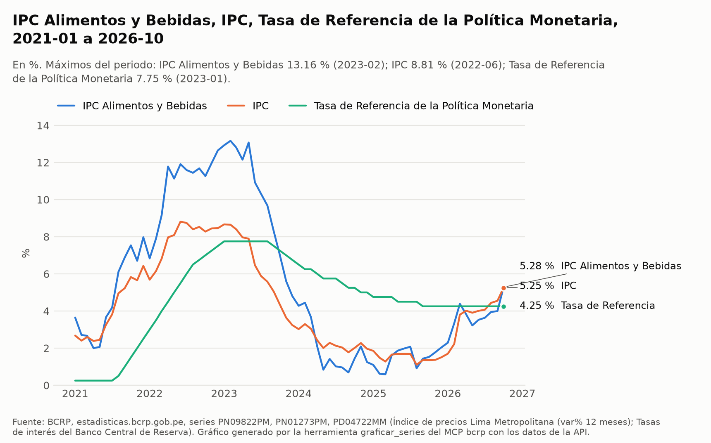
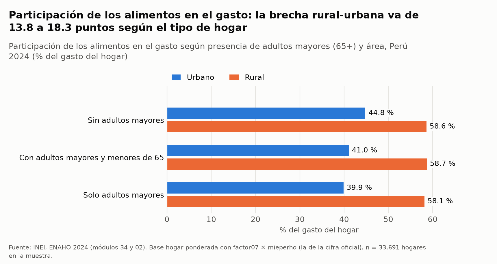
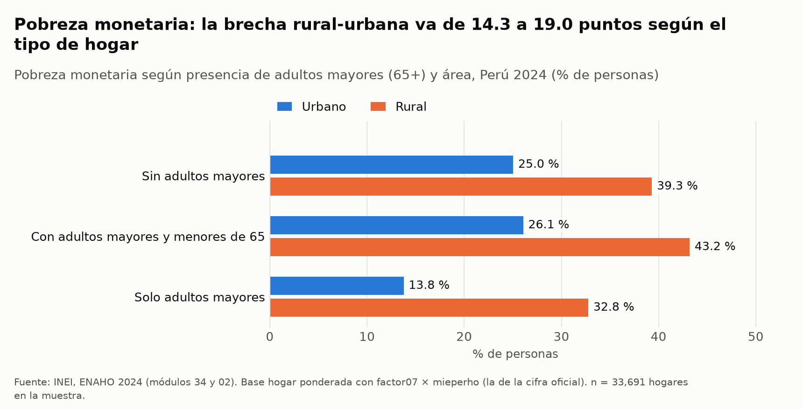
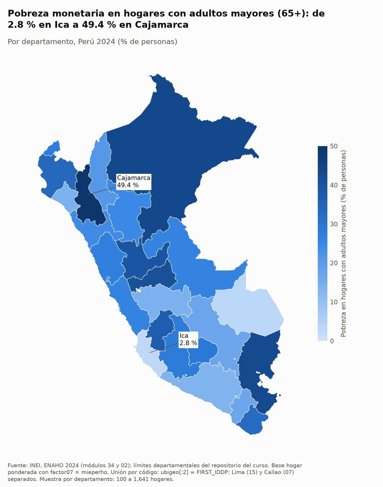

# ¿Están más expuestos a la inflación los hogares con adultos mayores? ENAHO 2024 y series del BCRP, 2021-2026

**Respuesta corta.** No de manera general: la exposición va de la mano con el área, no con la presencia de adultos mayores.
Con la inflación de alimentos de 2026-10 (PN09822PM, 5.28 %), los alimentos aportan de 2.11 a 3.10 pp a la inflación
del hogar (ENAHO 2024, base hogar, `factor07 × mieperho`). La brecha rural-urbana (0.73 a 0.97 pp) supera la que hay
entre tipos de hogar dentro de cada área (−0.26 pp como máximo). A igual tamaño (1 y 2 personas), los hogares de solo
adultos mayores son más pobres (+7.1 y +15.2 pp); su menor pobreza en bruto (20.3 %) va con su menor tamaño (1.44).

## 1. Pregunta de investigación

**Tema.** La exposición de los hogares peruanos a la inflación de alimentos según tengan o no miembros de 65 años o más,
y su relación con la pobreza monetaria y la estructura del hogar.

**Objetivo.** Comparar tres tipos de hogar en pobreza, pobreza extrema, tamaño y peso de los alimentos en el gasto:
*sin adultos mayores*, *con adultos mayores y menores de 65* y *solo adultos mayores*. Esa estructura de gasto de 2024 se
aplica luego a la inflación de alimentos que mide el BCRP, y se describe cómo se movieron juntas la inflación de
alimentos, la inflación total y la tasa de referencia entre 2021-01 y 2026-10.

**Delimitación.**
- Cubre la ENAHO 2024 del INEI (módulo 34, sumaria; módulo 02, miembros del hogar) a nivel nacional, urbano/rural y
  departamental, y tres series mensuales del BCRP entre 2021-01 y 2026-10.
- La exposición se mide solo por el peso de los alimentos en el gasto del hogar. No mide cuánto se endeudan o ahorran
  los hogares, que es el canal por el que la tasa de referencia llega a ellos, ni el uso de pensiones o programas
  sociales.
- No estima efectos causales. Las comparaciones son descriptivas y las correlaciones entre series agregadas solo
  describen co-movimiento.
- No usa índices de precios regionales: la inflación de alimentos es la de Lima Metropolitana.

## 2. Fuentes y metodología

**Series del BCRP** (MCP `bcrp`; fuente: API de estadisticas.bcrp.gob.pe). Todas son mensuales y van de 2021-01 a
2026-10, el último mes con dato (70 meses).

| Código | Serie | Origen (ficha) | Actualizada |
|---|---|---|---|
| PN09822PM | IPC Alimentos y Bebidas, Lima Metropolitana, var. % 12 meses | INEI | 2026-10-08 |
| PN01273PM | IPC, Lima Metropolitana, var. % 12 meses (inflación total) | INEI | 2026-10-08 |
| PD04722MM | Tasa de Referencia de la Política Monetaria | BCRP | 2026-10-15 |

Procesamiento: `buscar_series` para ubicar los códigos, la ficha `bcrp://serie/{codigo}` de las tres series, `resumen`
de cada una, `correlacion` sin rezago y con `rezago=6` (compara la serie a en t con la serie b en t + 6) y
`graficar_series`, que dejó `figuras/bcrp_inflacion_tasa_2021_2026.png` y su CSV.

**ENAHO 2024** (skills `limpiando-enaho`, `graficando-enaho` y `mapeando-enaho`, versión tarea_4).
- Archivos: `sumaria-2024.dta` (33,691 hogares) y `enaho01-2024-200.dta` (117,721 filas). Se toman los residentes
  habituales, que son 108,664 personas, y se unen con la sumaria m:1 por `conglome`, `vivienda` y `hogar`.
- Validación (`salidas/validacion.txt`): 15 de 15 comprobaciones esenciales aprobadas. La pobreza nacional sale 27.58 %
  (referencia 27.6 %), la urbana 24.81 % (24.8 %) y la rural 39.30 % (39.3 %), todas con base hogar y
  `factor07 × mieperho`. La pobreza extrema sale 5.50 % (INEI 5.5 %). Hay 25 unidades territoriales. Los 8 grupos de
  gasto del INEI suman `gashog2d` en todos los hogares.
- **Tipo de hogar**, según las edades de sus residentes del módulo 02: *sin adultos mayores* (ninguno de 65+),
  *con adultos mayores y menores de 65* (al menos uno de 65+ y al menos uno menor) y *solo adultos mayores* (todos 65+).
- **Indicadores** (`salidas/indicadores.csv`):
  - `pobreza` y `pobreza_extrema`: % de personas, con `pobreza <= 2` y `pobreza == 1` respectivamente.
  - `part_alimentos`: `100 × g1_alimentos / g0_total`, promedio ponderado.
  - `mieperho_medio`: personas por hogar.
  - `hogares`: % de hogares.
  - `personas`: % de personas.
  - `rural`: % de las personas de cada tipo que viven en el área rural.
  - `gasto_pc_mensual`: soles corrientes por persona al mes.
- **Ponderación.** Toda cifra «% de personas» y todo promedio de `part_alimentos` o de gasto usan la base hogar con
  `factor07 × mieperho`. Las cifras «% de hogares» y `mieperho_medio` usan `factor07`, y así se indica en cada tabla.
- **Control por tamaño.** El tamaño es `mieperho` y se agrupa en 1, 2, 3 a 4 y 5 o más personas. Toda celda con menos
  de 100 hogares en la muestra (`n_muestral`) se marca como **no confiable**.

**Definición de exposición.** Es la contribución aproximada de los alimentos a la inflación del hogar, en puntos
porcentuales:

> contribución (pp) = `part_alimentos` × PN09822PM del último mes con dato (2026-10) / 100

La calcula `informes/calculos_exposicion.py`, que lee `salidas/indicadores.csv` y
`figuras/bcrp_inflacion_tasa_2021_2026.csv`. Como sensibilidad, también la calcula con el pico de PN09822PM en el
periodo (2023-02).

## 3. Resultados

### Hallazgo 1. La inflación de alimentos tuvo un pico más alto que la inflación total y va de la mano con ella; con la tasa de referencia la asociación es más estrecha seis meses después

| Serie (2021-01 a 2026-10) | 2021-01 | 2026-10 | Cambio | Promedio | Máximo | Mínimo |
|---|---|---|---|---|---|---|
| PN09822PM alimentos y bebidas | 3.65 % | 5.28 % | +1.64 pp | 5.50 % | 13.16 % (2023-02) | 0.59 % (2025-03) |
| PN01273PM inflación total | 2.68 % | 5.25 % | +2.58 pp | 4.31 % | 8.81 % (2022-06) | 1.11 % (2025-08) |
| PD04722MM tasa de referencia | 0.25 % | 4.25 % | +4.00 pp | 4.73 % | 7.75 % (2023-01) | 0.25 % (2021-01) |

*Fuente: `resumen` del MCP `bcrp`, 70 meses por serie.*

- **Alimentos frente a la inflación total** (`correlacion`, 2021-01 a 2026-10). Sin rezago, r = 0.9719 (fuerte y
  positiva, 70 pares). La inflación de alimentos (PN09822PM) estuvo por encima de la total (PN01273PM) en 48 de 70
  meses, con una brecha media de 1.19 pp. Con `rezago=6`, r = 0.648 (moderada, 64 pares).
- **Alimentos frente a la tasa de referencia** (`correlacion`, 2021-01 a 2026-10). Sin rezago, r = 0.4422 (moderada,
  70 pares; brecha media PN09822PM − PD04722MM de 0.78 pp; los alimentos estuvieron por encima en 35 de 70 meses).
  Con `rezago=6`, r = 0.7611 (fuerte, 64 pares). La tasa de referencia se asocia más con la inflación de alimentos de
  seis meses antes que con la del mismo mes. Es co-movimiento entre agregados, no causalidad.
- **Último dato** (CSV de `graficar_series`). En 2026-10 la brecha entre alimentos y total es de apenas +0.03 pp. En el
  pico de 2023-02 llegó a +4.52 pp. PN09822PM pasó de 3.99 % en 2026-09 a 5.28 % en 2026-10.

### Hallazgo 2. Los hogares de solo adultos mayores tienen menos pobreza en bruto, pero a igual tamaño tienen más

**Por tipo de hogar, nacional** (ENAHO 2024, `salidas/indicadores.csv`, corte `tipo_hogar_am`)

| Tipo de hogar | Pobreza | Pobreza extrema | Personas por hogar (`mieperho_medio`) | % de hogares | % de personas | % rural | Gasto per cápita (S/ al mes) | n hogares |
|---|---|---|---|---|---|---|---|---|
| Sin adultos mayores | 27.9 % | 5.6 % | 3.52 | 69.4 % | 73.5 % | 19.8 % | 762.0 | 23,292 |
| Con adultos mayores y menores de 65 | 28.4 % | 5.4 % | 3.79 | 18.9 % | 21.5 % | 13.4 % | 770.2 | 5,930 |
| Solo adultos mayores | 20.3 % | 5.0 % | 1.44 | 11.8 % | 5.1 % | 34.2 % | 977.1 | 4,469 |

*Ponderador: `factor07 × mieperho` para pobreza, % de personas, % rural y gasto; `factor07` para personas por hogar y
% de hogares. Perú: pobreza 27.6 %, 3.33 personas por hogar. El 30.6 % de los hogares tiene al menos un adulto mayor
(`factor07`, n = 33,691), y en el 22.6 % de esos hogares el adulto mayor vive solo (`factor07`, n = 10,399).*

**Sin controlar por tamaño, la comparación no es limpia.** La pobreza monetaria es per cápita y los hogares de solo
adultos mayores tienen 1.44 personas en promedio, frente a 3.52 y 3.79 en los otros tipos. Tienen además el gasto per
cápita más alto (S/ 977.1 al mes) y la mayor proporción rural (34.2 %). La cifra bruta de 20.3 % mezcla esas
diferencias de tamaño y de área.

**Por tipo de hogar y área** (ENAHO 2024, base hogar, `factor07 × mieperho`; personas por hogar con `factor07`)

| Área | Tipo de hogar | Pobreza | Pobreza extrema | Personas por hogar | n hogares | ¿Confiable? |
|---|---|---|---|---|---|---|
| Urbano | Sin adultos mayores | 25.0 % | 3.2 % | 3.51 | 15,489 | sí |
| Urbano | Con adultos mayores y menores de 65 | 26.1 % | 3.2 % | 3.87 | 4,312 | sí |
| Urbano | Solo adultos mayores | 13.8 % | 1.3 % | 1.45 | 2,230 | sí |
| Rural | Sin adultos mayores | 39.3 % | 15.1 % | 3.58 | 7,803 | sí |
| Rural | Con adultos mayores y menores de 65 | 43.2 % | 19.6 % | 3.31 | 1,618 | sí |
| Rural | Solo adultos mayores | 32.8 % | 12.2 % | 1.42 | 2,239 | sí |

Dentro de cada área (diferencias de `calculos_exposicion.py`):
- Los hogares de solo adultos mayores tienen menos pobreza que los hogares sin adultos mayores: −11.3 pp en lo urbano
  y −6.5 pp en lo rural.
- Los hogares con adultos mayores y menores de 65 tienen más pobreza: +1.0 pp en lo urbano y +3.9 pp en lo rural.
- La pobreza extrema más alta de toda la tabla es la de los hogares rurales con adultos mayores y menores (19.6 %).

**Por tipo de hogar y tamaño** (ENAHO 2024, corte `tipo_hogar_am × tamano`, base hogar, `factor07 × mieperho`)

| Tamaño (`mieperho`) | Sin adultos mayores | Con adultos mayores y menores de 65 | Solo adultos mayores |
|---|---|---|---|
| 1 persona | 4.0 % (n = 2,914) | 0.0 % (n = 43) **no confiable** | 11.2 % (n = 2,639) |
| 2 personas | 10.7 % (n = 3,909) | 16.4 % (n = 1,704) | 25.8 % (n = 1,771) |
| 3 a 4 personas | 21.5 % (n = 10,741) | 21.5 % (n = 2,642) | 30.7 % (n = 55) **no confiable** |
| 5 o más personas | 41.1 % (n = 5,728) | 38.2 % (n = 1,541) | 96.8 % (n = 4) **no confiable** |

A igual tamaño, el orden se invierte. Frente a hogares sin adultos mayores del mismo tamaño:
- Los hogares unipersonales de un adulto mayor tienen +7.1 pp de pobreza.
- Los de dos personas que son solo adultos mayores tienen +15.2 pp.
- Los de dos personas con adultos mayores y menores de 65 tienen +5.7 pp.
- En 3 a 4 personas, los hogares con adultos mayores y menores tienen prácticamente la misma pobreza (−0.0 pp).
- En 5 o más personas tienen −2.9 pp.

### Hallazgo 3. La exposición a la inflación de alimentos se asocia con el área, no con la presencia de adultos mayores

**Participación de los alimentos y contribución aproximada a la inflación del hogar** (ENAHO 2024, base hogar,
`factor07 × mieperho`, × PN09822PM; salida de `informes/calculos_exposicion.py`)

| Área | Tipo de hogar | Alimentos (% del gasto) | Contribución con PN09822PM 2026-10 (5.28 %) | Contribución con PN09822PM 2023-02 (13.16 %) | Pobreza | Personas por hogar | n hogares |
|---|---|---|---|---|---|---|---|
| Urbano | Sin adultos mayores | 44.8 % | 2.37 pp | 5.90 pp | 25.0 % | 3.51 | 15,489 |
| Urbano | Con adultos mayores y menores de 65 | 41.0 % | 2.17 pp | 5.40 pp | 26.1 % | 3.87 | 4,312 |
| Urbano | Solo adultos mayores | 39.9 % | 2.11 pp | 5.25 pp | 13.8 % | 1.45 | 2,230 |
| Rural | Sin adultos mayores | 58.6 % | 3.10 pp | 7.71 pp | 39.3 % | 3.58 | 7,803 |
| Rural | Con adultos mayores y menores de 65 | 58.7 % | 3.10 pp | 7.72 pp | 43.2 % | 3.31 | 1,618 |
| Rural | Solo adultos mayores | 58.1 % | 3.07 pp | 7.65 pp | 32.8 % | 1.42 | 2,239 |

Todas las celdas tienen 100 hogares o más.

- **Dentro de lo urbano**, los hogares con adultos mayores destinan menos de su gasto a alimentos. Frente a los hogares
  sin adultos mayores, los de solo adultos mayores tienen −4.9 pp de participación y −0.26 pp de contribución en
  2026-10 (−0.65 pp en 2023-02). Los de adultos mayores con menores tienen −3.8 pp de participación y −0.20 pp de
  contribución (−0.49 pp en 2023-02).
- **Dentro de lo rural**, la participación es casi igual entre tipos de hogar: +0.1 pp y −0.5 pp. Las contribuciones
  difieren en +0.00 pp y −0.02 pp. Diferencias tan chicas pueden no ser significativas.
- **Entre áreas**, para un mismo tipo de hogar, lo rural supera a lo urbano por +13.8 a +18.3 pp de participación y
  +0.73 a +0.97 pp de contribución en 2026-10. La brecha más grande es la de los hogares de solo adultos mayores. La
  contribución va de 2.11 pp (solo adultos mayores, urbano) a 3.10 pp (adultos mayores con menores, rural).
- **Nacional**, la participación es 47.5 % sin adultos mayores, 43.4 % con adultos mayores y menores y 46.1 % solo
  adultos mayores (Perú: 46.6 %). Las contribuciones en 2026-10 son 2.51, 2.29 y 2.44 pp. Los hogares de solo adultos
  mayores salen más cerca del promedio en lo nacional que dentro de cada área porque el 34.2 % de sus personas vive en
  lo rural.
- **A igual tamaño** (corte `tipo_hogar_am × tamano`), los hogares de solo adultos mayores gastan algo más en
  alimentos. En 1 persona tienen 45.2 % frente a 43.8 % (+1.4 pp; contribución +0.08 pp). En 2 personas tienen
  46.9 % frente a 44.7 % (+2.2 pp; contribución +0.11 pp). En 3 a 4 y 5 o más personas, los hogares con adultos
  mayores y menores gastan menos (−4.4 y −5.3 pp; contribución −0.23 y −0.28 pp).

### Hallazgo 4. La pobreza de los hogares con adultos mayores varía mucho por departamento

Pobreza de las personas en hogares con al menos un adulto mayor (`mapeando-enaho`, `--indicador pobreza_hogares_am`,
base hogar, `factor07 × mieperho`; `mapas/pobreza_hogares_am_departamento_2024.csv`). Al lado va la pobreza total del
departamento (`salidas/indicadores.csv`, corte `departamento`, mismo ponderador).

| Departamento | Pobreza en hogares con adultos mayores | n hogares con adultos mayores | Pobreza total del departamento |
|---|---|---|---|
| Cajamarca | 49.4 % | 470 | 45.0 % |
| Loreto | 43.8 % | 371 | 43.0 % |
| Puno | 43.1 % | 386 | 39.9 % |
| Arequipa | 13.5 % | 423 | 15.8 % |
| Madre de Dios | 3.8 % | 100 | 11.1 % |
| Ica | 2.8 % | 439 | 6.0 % |

Las 25 unidades territoriales se unieron por código y ninguna quedó sin dato. La muestra va de 100 a 1,641 hogares con
adultos mayores por departamento, así que ninguna celda baja de 100. Madre de Dios queda justo en el umbral (n = 100) y
su cifra debe leerse con cautela.

## 4. Visualizaciones



*Lectura:* la inflación de alimentos (PN09822PM) subió más que la total (PN01273PM) y tocó 13.16 % en 2023-02. La tasa
de referencia (PD04722MM) subió hasta 7.75 % en 2023-01, bajó más tarde que la inflación y en 2026-10 estaba en 4.25 %,
con las dos inflaciones en 5.28 % y 5.25 %.



*Lectura:* lo que separa a las barras es el área. En lo rural los tres tipos de hogar destinan alrededor de 58 % del
gasto a alimentos (58.1 % a 58.7 %). En lo urbano, los hogares con adultos mayores destinan menos: 41.0 % y 39.9 %,
frente a 44.8 % (ENAHO 2024, `factor07 × mieperho`).



*Lectura:* en ambas áreas los hogares de solo adultos mayores tienen la pobreza más baja (13.8 % urbano, 32.8 % rural) y
los de adultos mayores con menores, la más alta (26.1 % y 43.2 %). Este gráfico no controla por tamaño: ver la tabla por
tamaño del hallazgo 2.



*Lectura:* los tonos más oscuros, de mayor pobreza en hogares con adultos mayores, están en Cajamarca (49.4 %), Loreto
(43.8 %) y Puno (43.1 %). Los más claros están en Ica (2.8 %) y Madre de Dios (3.8 %, con n = 100) (ENAHO 2024,
`factor07 × mieperho`).

## 5. Interpretación

1. **En los datos de 2024, tener adultos mayores en el hogar no se asocia con una mayor exposición a la inflación de
   alimentos.** El peso de
   los alimentos en el gasto, y con él la contribución aproximada de los alimentos a la inflación del hogar, va de la
   mano con el área de residencia. En lo urbano los hogares con adultos mayores incluso aparecen algo menos expuestos.
   En lo rural no se distinguen de los demás.
2. **La vulnerabilidad de los hogares con adultos mayores se ve en la pobreza, y depende de cómo se compare.** En bruto,
   los hogares de solo adultos mayores parecen menos pobres (20.3 %). Ese resultado coincide con hogares mucho más chicos
   (1.44 personas) y con un gasto per cápita más alto. Comparados con hogares sin adultos mayores del mismo tamaño, son
   más pobres (+7.1 pp en 1 persona, +15.2 pp en 2) y gastan una parte algo mayor en alimentos (+1.4 y +2.2 pp). Un
   adulto mayor que vive solo o en pareja está, a igual tamaño, en peor posición que un hogar joven del mismo tamaño.
3. **Los hogares multigeneracionales rurales son el grupo más frágil.** Tienen la pobreza (43.2 %) y la pobreza extrema
   (19.6 %) más altas de la tabla por área, y el peso de alimentos más alto (58.7 %). De los hogares con adultos
   mayores, es el que tiene menos margen ante alimentos más caros. Pero su contribución (3.10 pp en 2026-10) es igual a
   la de los hogares rurales sin adultos mayores.
4. **El contexto macro.** Entre 2021 y 2026 la inflación de alimentos estuvo por encima de la total en 48 de 70 meses.
   En el pico de 2023-02, la contribución aproximada de los alimentos habría sido de 7.65 a 7.72 pp en lo rural y de
   5.25 a 5.90 pp en lo urbano. En 2026-10 la inflación de alimentos y la total están casi iguales (+0.03 pp), así que
   el mayor peso de los alimentos casi no suma exposición frente a la inflación promedio. Aun así, PN09822PM subió de
   3.99 % a 5.28 % entre 2026-09 y 2026-10, un salto que conviene vigilar en los hogares rurales.
5. **Tasa de referencia.** Se asocia moderadamente con la inflación de alimentos del mismo mes (r = 0.4422) y con más
   fuerza con la de seis meses antes (r = 0.7611). Eso coincide con una política monetaria que se mueve después de la
   inflación. Pero este informe no mide cómo llega la tasa a los hogares con adultos mayores (crédito, ahorro,
   pensiones), así que no permite decir si esos hogares ganan o pierden con ella.

## 6. Limitaciones

- **Cobertura temporal.** La ENAHO es un corte de 2024 y las series del BCRP van de 2021-01 a 2026-10. La exposición
  aplica la estructura de gasto de 2024 a la inflación de 2026-10 (y de 2023-02). Supone que la participación de los
  alimentos no cambió, y no hay ENAHO de 2025 o 2026 en este análisis para comprobarlo.
- **Niveles de agregación distintos.** PN09822PM y PN01273PM son el IPC de **Lima Metropolitana**, y la ENAHO es
  **nacional**, con urbano, rural y departamentos. La inflación de alimentos rural o de otras ciudades puede ser distinta.
  La canasta del IPC tampoco es la de los hogares con adultos mayores: comen y compran otros productos. La contribución
  es una aproximación de primer orden.
- **Qué entra en el gasto.** `part_alimentos` usa los 8 grupos del do-file del INEI sobre `gashog2d`, el gasto bruto de
  la sumaria. No separé lo comprado en el mercado de lo no monetario. Si el grupo de alimentos incluye autoconsumo o
  donaciones, la exposición a precios de mercado estaría sobrestimada, sobre todo en lo rural. La sumaria 2024 no trae
  `gru52hd2`, que se tomó como 0 (`salidas/validacion.txt`).
- **Calidad de los datos y muestra.**
  - La ENAHO es una muestra y no hay intervalos de confianza. Diferencias menores a un punto pueden no ser
    significativas, como las de participación en lo rural (+0.1 y −0.5 pp) o las contribuciones de +0.00 a −0.02 pp.
  - Tres celdas por tamaño tienen menos de 100 hogares y son **no confiables**: con adultos mayores y menores · 1
    persona (n = 43), solo adultos mayores · 3 a 4 (n = 55) y solo adultos mayores · 5 o más (n = 4, pobreza 96.8 %).
  - Esas celdas además salen de una inconsistencia de definiciones. El tipo de hogar se arma con los residentes del
    módulo 02 y el tamaño con `mieperho` de la sumaria, que según la referencia de la skill no coinciden en todos los
    hogares. Por eso existen hogares de «1 persona» que tienen adultos mayores y menores de 65.
  - Madre de Dios tiene justo 100 hogares con adultos mayores en el mapa.
- **El control por tamaño es parcial.** Compara dentro de cada tamaño o dentro de cada área, pero no las dos cosas a la
  vez. Tampoco controla ingresos por pensiones ni transferencias. La pobreza monetaria es per cápita y no usa escalas
  de equivalencia, una medida que tiende a mostrar menos pobreza en los hogares chicos.
- **Ficha de PD04722MM.** La ficha `bcrp://serie/PD04722MM` y el catálogo de `buscar_series` dicen inicio **Ene-2004**.
  Pero `resumen` desde 2003-01 devuelve datos desde **2003-09**: 278 meses hasta 2026-10, el primero de 2.75 %, con
  máximo de 7.75 % en 2023-01 y mínimo de 0.25 % en 2020-04. `serie` confirma valores en 2003-09 y 2003-10 (2.75 %) y
  en 2003-11 y 2003-12 (2.50 %). **El catálogo y los datos no coinciden.** El periodo de este informe (2021-01 a
  2026-10) no se ve afectado, pero quien use la serie larga no debe fiarse del inicio que dice la ficha.
- **Correlaciones.** Las correlaciones con `rezago=6` usan 64 pares, no 70. Son correlaciones entre series agregadas y
  no dicen nada sobre la causalidad ni sobre los hogares individuales.
- **Alcance de las conclusiones.** Valen para el Perú de 2024 y para un solo canal de exposición, el peso de los
  alimentos en el gasto. No informan sobre otros canales (vivienda, salud, deudas) en los que los adultos mayores
  podrían estar más expuestos.

## 7. Reproducibilidad

Todo se corre desde `tarea_4/`.

**MCP `bcrp`** (servidor en `mcp/server.py`, configurado en `.mcp.json`):
- `buscar_series`: «alimentos y bebidas 12 meses», «ipc 12 meses» y «tasa de referencia», con `frecuencia="Mensual"`.
- Fichas `bcrp://serie/PN09822PM`, `bcrp://serie/PN01273PM` y `bcrp://serie/PD04722MM`.
- `resumen` de PN09822PM, PN01273PM y PD04722MM con `desde="2021-01"` y `hasta="2026-12"` (el último dato es
  2026-10), y de PD04722MM con `desde="2003-01"` y `hasta="2026-10"`.
- `serie` de PD04722MM con `desde="2003-01"` y `hasta="2004-02"`.
- `correlacion` de PN09822PM con PN01273PM y de PN09822PM con PD04722MM, con `desde="2021-01"` y `hasta="2026-10"`,
  con `rezago=0` y con `rezago=6`.
- `graficar_series` con `codigos=["PN09822PM", "PN01273PM", "PD04722MM"]`, `desde="2021-01"`, `hasta="2026-10"` y
  `nombre_archivo="bcrp_inflacion_tasa_2021_2026"`.

**Skills de la ENAHO** (requieren `datos/966-Modulo34/` y `datos/966-Modulo02/` del INEI):

```bash
uv run .claude/skills/limpiando-enaho/scripts/limpiar.py --anio 2024
uv run .claude/skills/graficando-enaho/scripts/graficar.py --corte tipo_hogar_area --indicador alimentos --anio 2024
uv run .claude/skills/graficando-enaho/scripts/graficar.py --corte tipo_hogar_area --indicador pobreza --anio 2024
uv run .claude/skills/mapeando-enaho/scripts/mapear.py --indicador pobreza_hogares_am --anio 2024
```

**Cálculo de la exposición:**

```bash
PYTHONIOENCODING=utf-8 uv run python informes/calculos_exposicion.py
```

**Archivos usados y generados:**
- `salidas/validacion.txt`, `salidas/indicadores.csv`, `salidas/hogares_2024.parquet` y `salidas/personas_2024.parquet`.
- `figuras/bcrp_inflacion_tasa_2021_2026.{png,csv}`, `figuras/alimentos_tipo_hogar_area_2024.{png,csv}` y
  `figuras/pobreza_tipo_hogar_area_2024.{png,csv}`.
- `mapas/pobreza_hogares_am_departamento_2024.{png,csv}`.
- `informes/calculos_exposicion.py` e `informes/informe_final.md`.

**Series:** PN09822PM, PN01273PM y PD04722MM.

## 8. Verificación de cifras

<!-- verificacion:inicio -->
Generada por `informes/verificar_informe.py`, que no usa el MCP ni las Skills: las cifras del BCRP se comprueban en la tabla HTML pública de estadisticas.bcrp.gob.pe (contrastada con el JSON de la API del mismo sitio) y las de la ENAHO con un cálculo directo desde los `.dta`. «Valor calculado» va con 4 decimales; la tolerancia es medio punto del último decimal que muestra el informe (0.002 para r, porque la tabla HTML redondea a 2 decimales).

| # | Fuente | Afirmación del informe | Valor en el informe | Valor calculado | Fuente o procedimiento de verificación | Diferencia | ¿Coincide? |
|---|---|---|---|---|---|---|---|
| 1 | BCRP | Inflación de alimentos y bebidas de Lima a 12 meses, 2026-10 (PN09822PM) | 5.28 | 5.2800 | tabla HTML de estadisticas.bcrp.gob.pe/estadisticas/series/mensuales/resultados/PN09822PM/html, fila Oct26 | +0.0000 | sí |
| 2 | BCRP | Máximo de PN09822PM entre 2021-01 y 2026-10 (en 2023-02) | 13.16 | 13.1600 | tabla HTML de estadisticas.bcrp.gob.pe/estadisticas/series/mensuales/resultados/PN09822PM/html, máximo de las 70 filas | +0.0000 | sí |
| 3 | BCRP | Correlación de alimentos con la inflación total, sin rezago, 2021-01 a 2026-10 | 0.9719 | 0.9718 | r de Pearson con numpy sobre las tablas HTML de PN09822PM y PN01273PM (valores a 2 decimales) | +0.0001 | sí |
| 4 | BCRP | Primer mes con dato de la tasa de referencia PD04722MM (la ficha dice Ene-2004) | 2003-09 | 2003-09 | tabla HTML de estadisticas.bcrp.gob.pe/estadisticas/series/mensuales/resultados/PD04722MM/html pedida desde 2003-1: primera fila | — | sí |
| 5 | ENAHO | Pobreza en hogares de solo adultos mayores (nacional) | 20.3 | 20.2572 | cálculo directo desde los .dta, factor07 × mieperho | +0.0428 | sí |
| 6 | ENAHO | Personas por hogar en hogares de solo adultos mayores (mieperho medio) | 1.44 | 1.4383 | cálculo directo desde los .dta, promedio de mieperho ponderado con factor07 | +0.0017 | sí |
| 7 | ENAHO | Pobreza en hogares unipersonales de un adulto mayor (control por tamaño) | 11.2 | 11.1635 | cálculo directo desde los .dta: mieperho = 1 y residente de 65+, factor07 × mieperho | +0.0365 | sí |
| 8 | ENAHO | Pobreza en hogares unipersonales sin adultos mayores (control por tamaño) | 4.0 | 4.0228 | cálculo directo desde los .dta: mieperho = 1 y ningún residente de 65+, factor07 × mieperho | -0.0228 | sí |
| 9 | Combinada | Contribución de los alimentos a la inflación de hogares rurales de solo adultos mayores, 2026-10 | 3.07 | 3.0700 | participación de alimentos directa de los .dta (factor07 × mieperho) × PN09822PM de la tabla HTML / 100 | +0.0000 | sí |

**9 de 9 afirmaciones coinciden.** Diferencias: el informe redondea; el r recalculado con valores a 2 decimales difiere del de `correlacion` (que usa la precisión completa de la API) en el cuarto decimal.
<!-- verificacion:fin -->
